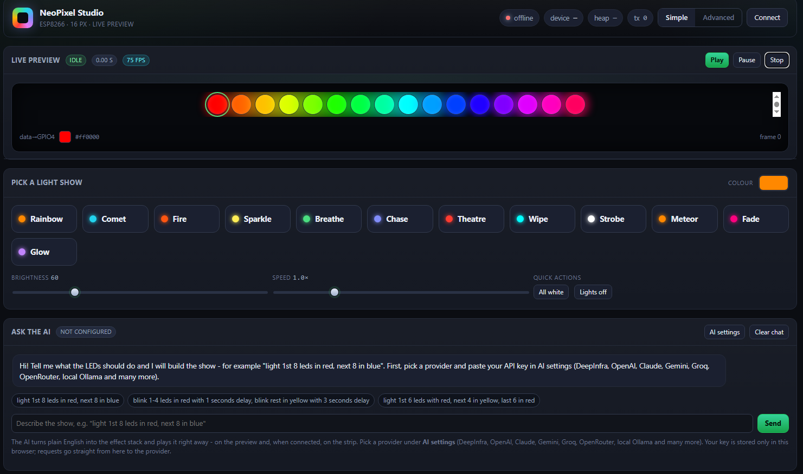
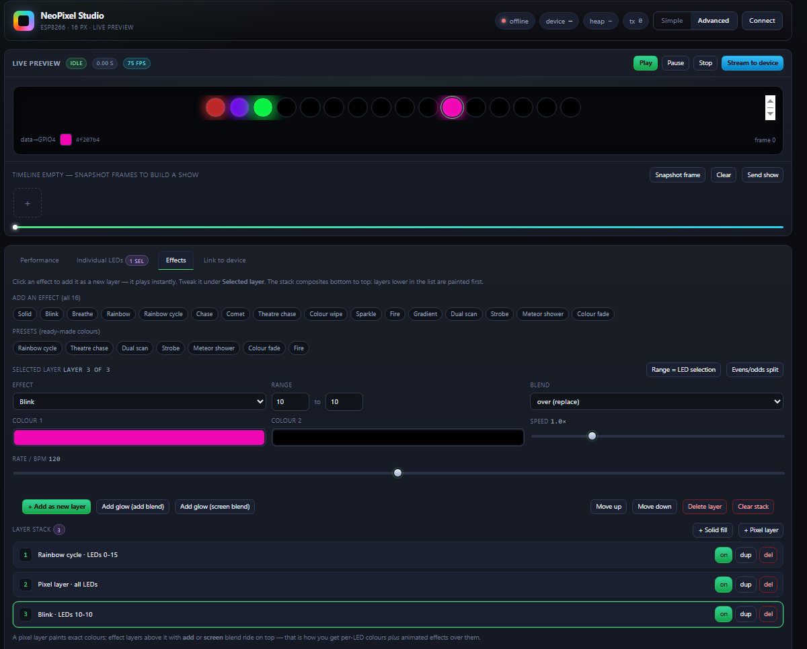

<p align="center">
  
</p>

<p align="center">
  <b>ESP8266 firmware & embedded web UI for WS2812B / NeoPixel LED strips</b>
</p>

---

**NeoPixel Studio** is a lightweight firmware and embedded web UI designed for ESP8266 (NodeMCU ESP-12E) microcontrollers running WS2812B / NeoPixel LED strips. The board serves the complete user interface directly from its internal flash memory and streams real-time control via WebSockets.

---

## 📸 User Interface

| Simple Mode (with AI Chat) | Advanced Mode |
| :---: | :---: |
|  |  |

---

## Repository Layout

| File | What it is |
| :--- | :--- |
| `NeoPixelStudio.ino` | Firmware: web server, WebSocket link, effect engine, playback |
| `web/index.html` | **Source of truth for the web UI** (single file, no build step) |
| `ui_embedded.h` | Auto-generated: the UI as a PROGMEM C string. Do not edit |
| `tools/build_embedded_ui.py` | Encodes `web/index.html` → `ui_embedded.h` |
| `tools/decode_ui.py` | Extracts `ui_embedded.h` → `web/index.html` (for recovery) |

After making modifications to `web/index.html`, regenerate the C header and reflash your board using:

```bash
python tools/build_embedded_ui.py
