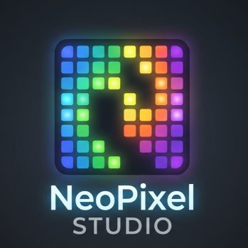

# NeoPixel Studio

<div align="center">



  <h3>Lightweight ESP8266 Firmware & Embedded Web UI for WS2812B / NeoPixel LED Strips</h3>

  <p align="center">
    <a href="#key-features">Key Features</a> •
    <a href="#repository-layout">Repository Layout</a> •
    <a href="#ai-chat-simple-mode">AI Chat Integration</a> •
    <a href="#supported-providers">Supported Providers</a> •
    <a href="#quick-start">Quick Start</a>
  </p>

  <p align="center">
    
    
    
    
  </p>

---

</div>

## Key Features

- **Self-Hosted Web UI:** The board serves the entire user interface directly from its onboard flash memory.
- **Real-Time WebSocket Stream:** Low-latency live control and real-time canvas preview.
- **AI-Powered Show Assistant:** Describe custom animation patterns in plain English using your favorite LLM provider.
- **Zero Build-Step Frontend:** Clean, single-file web client architecture for quick updates.

---

## Repository Layout

| File | Description |
| :--- | :--- |
| **`NeoPixelStudio.ino`** | Core firmware handling web server, WebSocket links, effect engine, and playback. |
| **`web/index.html`** | **Source of truth for the web UI** (single file, no build step needed). |
| **`ui_embedded.h`** | Auto-generated header containing the UI as a `PROGMEM` C string (*do not edit directly*). |
| **`tools/build_embedded_ui.py`** | Script to encode `web/index.html` → `ui_embedded.h`. |
| **`tools/decode_ui.py`** | Script to extract `ui_embedded.h` → `web/index.html` for recovery. |

### Updating the UI

After making changes to `web/index.html`, regenerate the C header file and reflash your board:

```bash
python tools/build_embedded_ui.py
```

---

## AI Chat (Simple Mode)

The Simple tab includes an integrated **Ask the AI** panel. Simply describe your lighting setup or animation ideas in plain English, and the AI assistant will translate them into the app's effect stack, render a live preview instantly, and push the configuration to the micro-controller.

Each applied plan displays a step-by-step breakdown of what was generated, along with an **Undo** action.

```
                  ┌───────────────────────────────┐
                  │   User Prompt (Plain English) │
                  └──────────────┬────────────────┘
                                 │
                                 ▼
                  ┌───────────────────────────────┐
                  │    LLM API (Browser / BYOK)   │
                  └──────────────┬────────────────┘
                                 │
                                 ▼
                  ┌───────────────────────────────┐
                  │  JSON Plan (Layers & Speed)   │
                  └──────────────┬────────────────┘
                                 │
                  ┌──────────────┴──────────────┐
                  ▼                             ▼
       ┌────────────────────┐        ┌────────────────────┐
       │ Live Canvas Preview│        │ WebSockets to ESP  │
       └────────────────────┘        └────────────────────┘
```

### Example Prompts

- *"light 1st 8 leds in red, next 8 in blue"*
- *"blink 1-4 leds in red with 1 seconds delay, blink rest in yellow with 3 seconds delay"*
- *"light 1st 6 leds with red, next 4 in yellow, last 6 in red"*

### How It Works

1. **Direct Browser Execution:** The browser talks **directly** to the provider's chat-completions API using your API key (BYOK). The ESP8266 never touches your key and avoids overhead.
2. **Deterministic Layer Mapping:** The system prompt defines the 16 builtin effects, layer blending models, and `bpm`-to-seconds conversion math ($period = \frac{30}{bpm} \text{ seconds}$), accurately mapping *"1 second delay"* to `bpm 30`.
3. **Optimized Layer Merging:** The response is formatted into a lightweight JSON schema (`layers`, optional `brightness` / `globalSpeed`), instantiated via standard `mkEffect` / `mkSolid` / `mkPixels` factories.
4. **Privacy First:** Keys and provider settings remain isolated in your browser's local storage (`nps-ai`).

---

## Supported Providers

NeoPixel Studio works out-of-the-box with a broad selection of hosted and local LLM options:

| Category | Providers |
| :--- | :--- |
| **Cloud Providers** | DeepInfra *(default)*, OpenAI, Anthropic (Claude), Google Gemini, OpenRouter, Groq, Mistral, DeepSeek, xAI (Grok), Together AI, Fireworks, Cerebras, Perplexity, Cohere, Hugging Face Router, NVIDIA NIM, Alibaba Qwen, Moonshot (Kimi), Zhipu GLM, 01.AI (Yi), Azure OpenAI |
| **Local Models** | Ollama, LM Studio (*No API keys needed*) |
| **Custom** | Any standard OpenAI-compatible API endpoint |

> **Note:** Base URLs are configurable, and the **Load** button will fetch dynamic model lists for supported endpoints. Anthropic calls send `anthropic-dangerous-direct-browser-access` headers to operate directly inside the browser.

---

## Quick Start

1. **Flash Firmware:** Open `NeoPixelStudio.ino` in Arduino IDE or PlatformIO, install required dependencies, and upload to your ESP8266 board.
2. **Connect Hardware:** Connect your WS2812B LED strip data pin to the designated GPIO pin.
3. **Access Interface:** Connect to the Wi-Fi network served by the ESP8266, open your web browser, and start designing effects!
